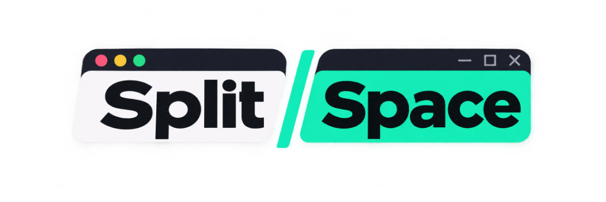
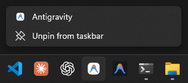
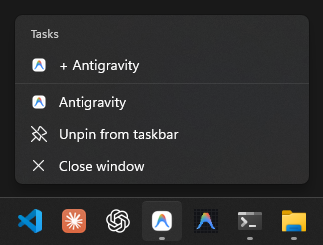
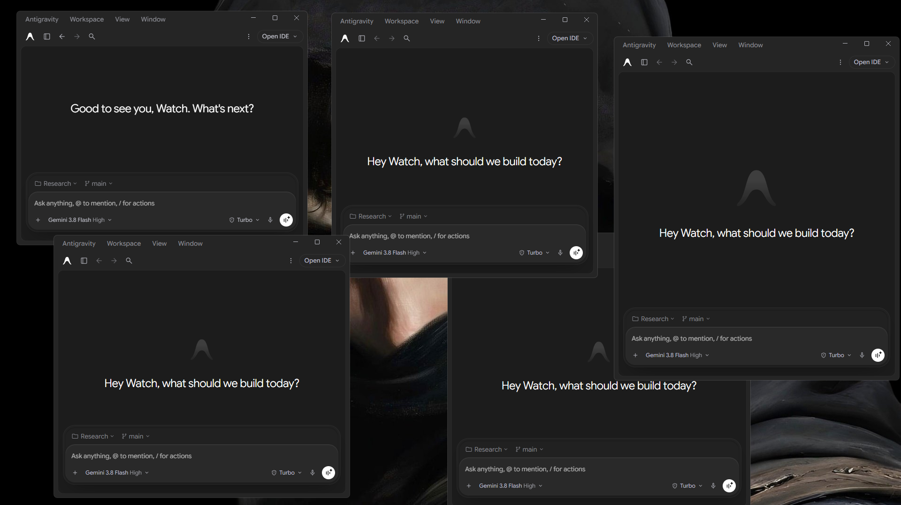
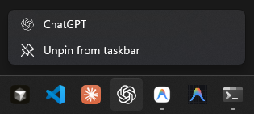
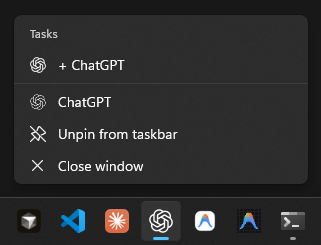
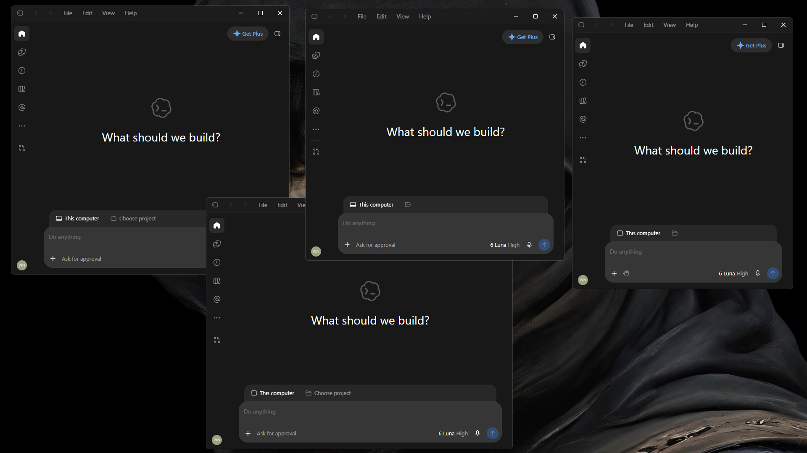
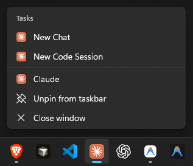
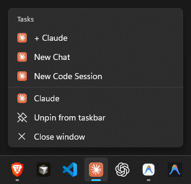
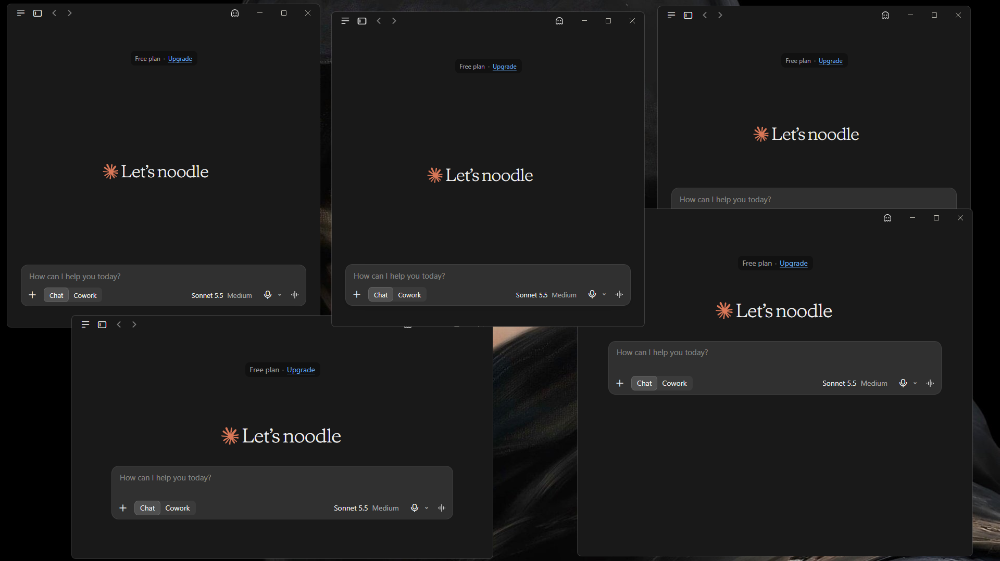

<p align="center">
  
</p>

<p align="center">
  
  
  
  
</p>

# SplitSpace

SplitSpace enables multi-window multitasking for AI desktop applications on Windows. It injects native Jump List tasks directly into your Windows Taskbar, allowing you to open independent floating windows with a single right-click while keeping them neatly grouped under their official taskbar icons.

---

## Visual Showcase

SplitSpace adds a `+ <AppName>` task to your right-click taskbar menu. Every click opens an independent, fully authenticated floating window for parallel projects and prompts.

### 1. Google Antigravity

| Default Taskbar Menu (Before) | SplitSpace Jump List Integration (After) |
| :---: | :---: |
|  |  |

<p align="center">
  <em>5 concurrent independent Google Antigravity workspaces running simultaneously side-by-side</em>
  <br><br>
  
</p>

---

### 2. OpenAI ChatGPT Desktop

| Default Taskbar Menu (Before) | SplitSpace Jump List Integration (After) |
| :---: | :---: |
|  |  |

<p align="center">
  <em>4 concurrent floating OpenAI ChatGPT desktop workspaces running in parallel</em>
  <br><br>
  
</p>

---

### 3. Anthropic Claude Desktop

| Default Taskbar Menu (Before) | SplitSpace Jump List Integration (After) |
| :---: | :---: |
|  |  |

<p align="center">
  <em>5 concurrent authenticated Anthropic Claude Desktop windows executing parallel conversations</em>
  <br><br>
  
</p>

---

## Supported Applications

| Application | Single-Window Limitation | With SplitSpace |
| :--- | :--- | :--- |
| **Google Antigravity** | Suppresses secondary launches; refocuses current window | Unlimited floating workspace windows grouped under the white taskbar icon |
| **OpenAI ChatGPT Desktop** | Locked to a single window; forces in-app conversation switching | Concurrent parallel prompt sessions with official vector emblem |
| **Anthropic Claude Desktop** | Single-instance lock blocks additional windows | Concurrent authenticated sessions side-by-side; preserves New Chat & Code Session |

> [!NOTE]
> Cursor is excluded because it already has its own built-in feature to open multiple windows (`Ctrl+Shift+N` or File > New Window).

---

## Quick Start

Open Windows PowerShell (no administrator privileges required) and run:

### 1. Install
```powershell
powershell -ExecutionPolicy Bypass -File .\install.ps1
```
Scans your system, detects installed AI apps, and registers right-click taskbar tasks.

### 2. How to Use
1. Right-click the app icon on your Windows Taskbar (Antigravity, ChatGPT, or Claude).
2. Click **`+ Antigravity`**, **`+ ChatGPT`**, or **`+ Claude`**.
3. A new floating window opens immediately. Click it again anytime to open additional windows.

### 3. Uninstall
```powershell
powershell -ExecutionPolicy Bypass -File .\uninstall.ps1
```
Removes the `+ <AppName>` taskbar buttons and returns Windows to its default behavior.

---

## Command Reference

| Action | Command |
| :--- | :--- |
| **Install for All Apps** | `powershell -ExecutionPolicy Bypass -File .\install.ps1` |
| **Install Antigravity Only** | `powershell -ExecutionPolicy Bypass -File .\install.ps1 -App Antigravity` |
| **Install Claude Only** | `powershell -ExecutionPolicy Bypass -File .\install.ps1 -App Claude` |
| **Install ChatGPT Only** | `powershell -ExecutionPolicy Bypass -File .\install.ps1 -App ChatGPT` |
| **Custom Task Label** | `powershell -ExecutionPolicy Bypass -File .\install.ps1 -App Antigravity -TaskLabel "+ New Workspace"` |
| **Uninstall All Apps** | `powershell -ExecutionPolicy Bypass -File .\uninstall.ps1` |
| **Uninstall Single App** | `powershell -ExecutionPolicy Bypass -File .\uninstall.ps1 -App Claude` |

> [!TIP]
> If your PowerShell terminal is in a different directory, provide the full path to the script:  
> `powershell -ExecutionPolicy Bypass -File "C:\Path\To\SplitSpace\install.ps1"`  
> `powershell -ExecutionPolicy Bypass -File "C:\Path\To\SplitSpace\uninstall.ps1"`

---

## Contributing

Contributions, suggestions, and issue reports are welcome. Please read [CONTRIBUTING.md](CONTRIBUTING.md) for development guidelines, testing procedures, and code standards.

---

## Security

Please review [SECURITY.md](SECURITY.md) for our security architecture, local isolation boundaries, and vulnerability reporting procedures.

---

## License

This project is licensed under the MIT License - see the [LICENSE](LICENSE) file for details.
