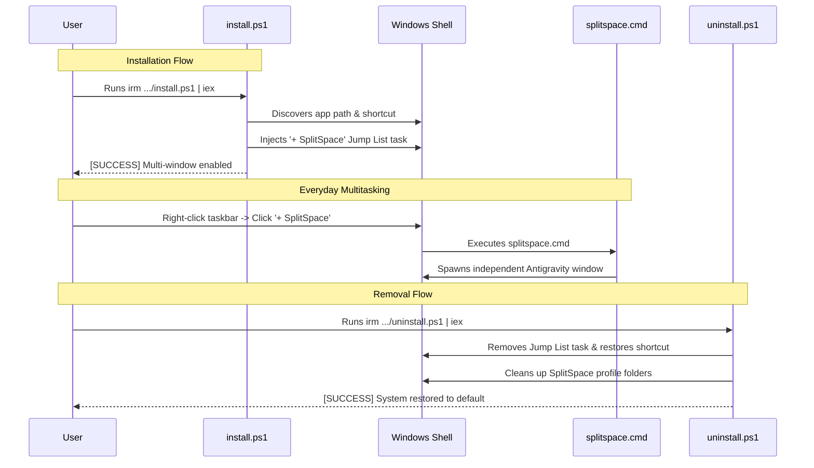

# SplitSpace Technical Architecture

This document outlines the system architecture, Windows process management, and session isolation mechanics implemented by SplitSpace.

---

## 1. The Single-Instance Mechanism in Electron & Chromium

Desktop applications like Antigravity, Claude Desktop, and ChatGPT Desktop use Electron's `app.requestSingleInstanceLock()` API:

```javascript
// Typical Electron single-instance enforcement
const gotTheLock = app.requestSingleInstanceLock();
if (!gotTheLock) {
  app.quit();
} else {
  app.on('second-instance', (event, commandLine, workingDirectory) => {
    if (mainWindow) {
      if (mainWindow.isMinimized()) mainWindow.restore();
      mainWindow.focus();
    }
  });
}
```

### How the Lock is Enforced on Windows
1. When the first instance launches, it binds to a Windows named pipe or local socket derived from its `userData` directory hash:
   `\\.\pipe\<user-data-hash>-lock`
2. It creates a filesystem lockfile at:
   `%APPDATA%\<AppName>\SingletonLock`
3. When a second process starts, it queries the named pipe.
4. If the pipe is active, it forwards its command-line arguments to the primary instance and terminates immediately.
5. If the application does not have multi-window handlers implemented in its `second-instance` listener, the primary instance simply focuses the existing window.

---

## 2. Decoupling Instances via Session Profiles

SplitSpace bypasses the singleton barrier by isolating the `--user-data-dir` argument:

```text
Primary Instance:
  UserData: %APPDATA%\Antigravity
  Lockfile: %APPDATA%\Antigravity\SingletonLock
  Pipe:     \\.\pipe\antigravity-primary-lock

Secondary Instance (SplitSpace):
  UserData: %LOCALAPPDATA%\SplitSpace\profiles\slot-1
  Lockfile: %LOCALAPPDATA%\SplitSpace\profiles\slot-1\SingletonLock
  Pipe:     \\.\pipe\splitspace-slot-1-lock
```

Because the userData directory path is unique, Chromium generates a distinct named pipe and process boundary. Both processes run simultaneously without awareness of each other's lockfiles.

---

## 3. Credential & State Synchronization

To ensure that opening a new window does not force the user to re-authenticate or log in again, SplitSpace uses a profile hydration strategy:

1. When a secondary profile is created under `%LOCALAPPDATA%\SplitSpace\profiles\slot-N`:
2. The launcher shim synchronizes essential authentication files from the primary profile:
   - `Cookies` and `Cookies-journal` (Network cookies)
   - `Local Storage\leveldb\` (Session state and active tokens)
   - `IndexedDB\` (Client caches)
3. Volatile locks and process-specific temporary files are excluded:
   - `SingletonLock`
   - `SingletonCookie`
   - `SingletonSocket`
   - `Crashpad\`
4. The secondary window launches immediately authenticated, ready for immediate work.

---

## 4. Windows Jump List Integration

Windows Taskbar Jump Lists are managed by the Windows Shell API. Custom actions appear in the **Tasks** category of the right-click menu:

```text
+------------------------------------+
| Recent                             |
|   Project-Frontend                 |
|   Project-Backend-API              |
|   Docs-Workspace                   |
+------------------------------------+
| Tasks                              |
|   + SplitSpace                     | <-- Injected by SplitSpace
|   [Target Application]             |
|   Unpin from taskbar               |
|   Close window                     |
+------------------------------------+
```

### Registration Flow
1. `lib/jumplist.ps1` opens the application's pinned taskbar shortcut or Start Menu shortcut.
2. It attaches a custom task:
   - **Name**: `+ SplitSpace`
   - **Path**: `%LOCALAPPDATA%\SplitSpace\bin\splitspace.cmd`
   - **Icon**: Points to `Antigravity.exe,0` (uses native app icon)
3. Windows Explorer updates its taskbar jump list cache immediately upon shortcut update.

---

## 5. Discovery Fallback Matrix

When `lib/discover.ps1` runs, it traverses the system in order of fastest resolution:

| Priority | Target Source | Detection Mechanism |
| :--- | :--- | :--- |
| 1 | Active Process | `Get-Process Antigravity -ErrorAction SilentlyContinue` |
| 2 | Current User AppData | `Test-Path "$env:LOCALAPPDATA\Programs\antigravity\Antigravity.exe"` |
| 3 | Windows User Registry | `HKCU:\Software\Microsoft\Windows\CurrentVersion\Uninstall\*` |
| 4 | Windows Machine Registry | `HKLM:\Software\Microsoft\Windows\CurrentVersion\Uninstall\*` |
| 5 | Start Menu Shortcuts | `$env:APPDATA\Microsoft\Windows\Start Menu\Programs\*.lnk` |

If all priority checks fail, the installer exits cleanly with an actionable error message rather than creating broken shortcuts.

---

## 6. Symmetrical Lifecycle Specification


