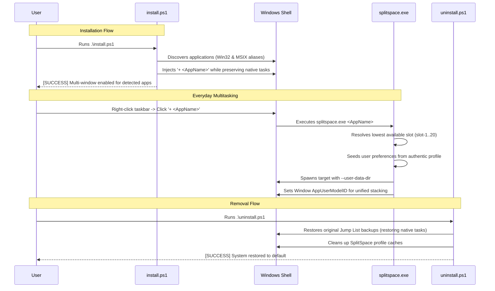

# SplitSpace Technical Architecture

This document outlines the system architecture, Windows process management, taskbar grouping mechanics, and session isolation implemented by SplitSpace.

---

## 1. The Single-Instance Mechanism in Electron & Chromium

Desktop applications like Google Antigravity, Anthropic Claude Desktop, and OpenAI ChatGPT Desktop use Electron's or Chromium's single-instance lock APIs (`app.requestSingleInstanceLock()`):

```javascript
// Typical Electron single-instance enforcement
const gotTheLock = app.requestSingleInstanceLock();
if (!gotTheLock) {
  app.quit();
} else {
  app.on('second-instance', (event, commandLine, workingDirectory) => {
    if (mainWindow) {
      if (mainWindow.isMinimized()) mainWindow.restore();
      mainWindow.focus();
    }
  });
}
```

### How the Lock is Enforced on Windows
1. When the first instance launches, it binds to a Windows named pipe or local socket derived from its `userData` directory hash:
   `\\.\pipe\<user-data-hash>-lock`
2. It creates a filesystem lockfile at:
   `%APPDATA%\<AppName>\SingletonLock` (or within package local cache)
3. When a second process starts, it queries the named pipe.
4. If the pipe is active, it forwards its command-line arguments to the primary instance and terminates immediately.
5. If the application does not have multi-window handlers implemented in its `second-instance` listener, the primary instance simply focuses the existing window.

---

## 2. Decoupling Instances via Dynamic Multi-Slot Allocation

SplitSpace bypasses the singleton barrier by isolating the `--user-data-dir` argument across dynamic profile slots:

```text
Primary Instance:
  UserData: %APPDATA%\Antigravity
  Lockfile: %APPDATA%\Antigravity\lockfile
  Scope:    Primary Default Session

Secondary Instance 1 (Slot 1):
  UserData: %LOCALAPPDATA%\SplitSpace\profiles\Antigravity\slot-1
  Lockfile: %LOCALAPPDATA%\SplitSpace\profiles\Antigravity\slot-1\lockfile
  Scope:    Independent Floating Window 1

Secondary Instance 2 (Slot 2):
  UserData: %LOCALAPPDATA%\SplitSpace\profiles\Antigravity\slot-2
  Lockfile: %LOCALAPPDATA%\SplitSpace\profiles\Antigravity\slot-2\lockfile
  Scope:    Independent Floating Window 2
```

Because each user data directory path is unique, Chromium generates a distinct named pipe and process boundary. Both processes run concurrently without colliding on singleton lockfiles or IPC channels.

### Dynamic Slot Allocation Algorithm
When the taskbar item is clicked, `splitspace.exe` executes:
1. Queries active process command lines via Win32 process APIs (`Win32_Process`) to identify currently occupied slots (`slot-1` through `slot-20`).
2. Identifies the lowest available slot number (reusing slots automatically when earlier windows are closed).
3. Verifies slot hydration; copies configuration and session files if the directory is newly initialized.
4. Spawns the target application with `--user-data-dir="%LOCALAPPDATA%\SplitSpace\profiles\<AppName>\slot-<N>"`.

---

## 3. Windows Taskbar Grouping & AppUserModelID (AUMID)

Windows 11 groups running application windows under taskbar icons according to their **Application User Model ID** (`AppUserModelID`).

### The MSIX Package Identity Challenge
Modern AI clients such as Anthropic Claude Desktop and OpenAI ChatGPT Desktop are distributed as MSIX / Windows Store packages:
- Claude Desktop AUMID: `Claude_pzs8sxrjxfjjc!Claude`
- OpenAI ChatGPT Desktop AUMID: `OpenAI.Codex_2p2nqsd0c76g0!App`

When an executable within `C:\Program Files\WindowsApps` is launched via raw Win32 process execution without package activation:
1. The operating system treats it as an unpackaged, generic Win32 executable.
2. It assigns an implicit file-path AUMID rather than the package AUMID.
3. Windows 11 pushes the running application to the far right of the taskbar as an ungrouped icon, rather than stacking under the pinned Store shortcut.
4. The window extracts the embedded PE binary icon rather than the official high-resolution vector Store asset.

### SplitSpace Unified Grouping Engine
SplitSpace ensures secondary windows stack directly into their pinned taskbar buttons with authentic logos through a three-tier synchronization:
1. **Package Execution Alias Routing**: Launches are dispatched through the official AppExecutionAlias (`%LOCALAPPDATA%\Microsoft\WindowsApps\<PackageFamily>\<AppAlias>.exe`), activating the authentic package container identity.
2. **Explicit Window Property Binding**: On process spawn, `splitspace.exe` queries top-level window handles (`HWND`) and invokes `SHGetPropertyStoreForWindow` to explicitly bind `System.AppUserModel.ID` (`PKEY_AppUserModel_ID: {9F4C2855-9F79-4B39-A8D0-E1D42DE1D5F3}, 5`).
3. **PropertyStore Shortcut Binding**: Sets `System.AppUserModel.ID` and `System.Title` directly on the task shortcut stream.

Result: Secondary and tertiary windows stack into the pinned taskbar icon with dual preview thumbnails, matching the gold-standard behavior demonstrated by Google Antigravity.

---

## 4. Multi-Task Jump List Binary Architecture

Windows Taskbar Jump Lists are stored as binary `CustomDestinations` streams in:
`%APPDATA%\Microsoft\Windows\Recent\CustomDestinations\<AumidHash>.customDestinations-ms`

### Multi-Task Preservation in Category 1
Applications like Claude Desktop define native Jump List tasks (`New Chat` and `New Code Session`). Naive replacement of Category 1 destroys these actions.

SplitSpace implements non-destructive binary stream assembly:
1. Reads existing Category 1 header (Type = 2) and records `ItemCount = N`.
2. Increments `ItemCount` to `N + 1`.
3. Injects the new SplitSpace ShellLink GUID (`{00021401-0000-0000-C000-000000000046}`) and task LNK bytes as Item 1 at the top of the tasks list.
4. Preserves all subsequent native tasks (`New Chat`, `New Code Session`) verbatim.
5. Preserves Category 2 Recent Folders and terminal records.
6. Emits `SHChangeNotify(SHCNE_ASSOCCHANGED)` to update the taskbar context menu instantly.

---

## 5. Why Cursor is Excluded from SplitSpace

Cursor is an advanced fork of Visual Studio Code. SplitSpace intentionally excludes Cursor for the following architectural reasons:
1. **Native Multi-Window Support**: Cursor already supports concurrent workspaces natively out of the box via `Ctrl+Shift+N` (File > New Window).
2. **Session Database Isolation**: Cursor maintains authentication tokens in an encrypted SQLite database (`state.vscdb`). Passing `--user-data-dir` forces a clean profile that disconnects existing credentials and prompts for re-login.
3. **Jump List Mutex Contention**: Cursor's internal C++ workbench constantly overwrites `CustomDestinations` on workspace focus changes, conflicting with external Jump List management.

For Cursor users, the built-in `Ctrl+Shift+N` shortcut remains the optimal multi-window solution.

---

## 6. Symmetrical Lifecycle Specification


